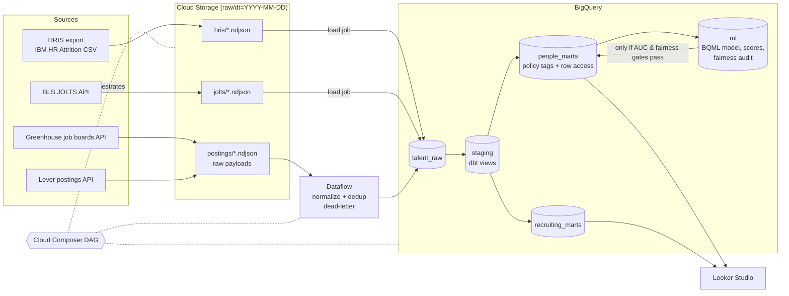
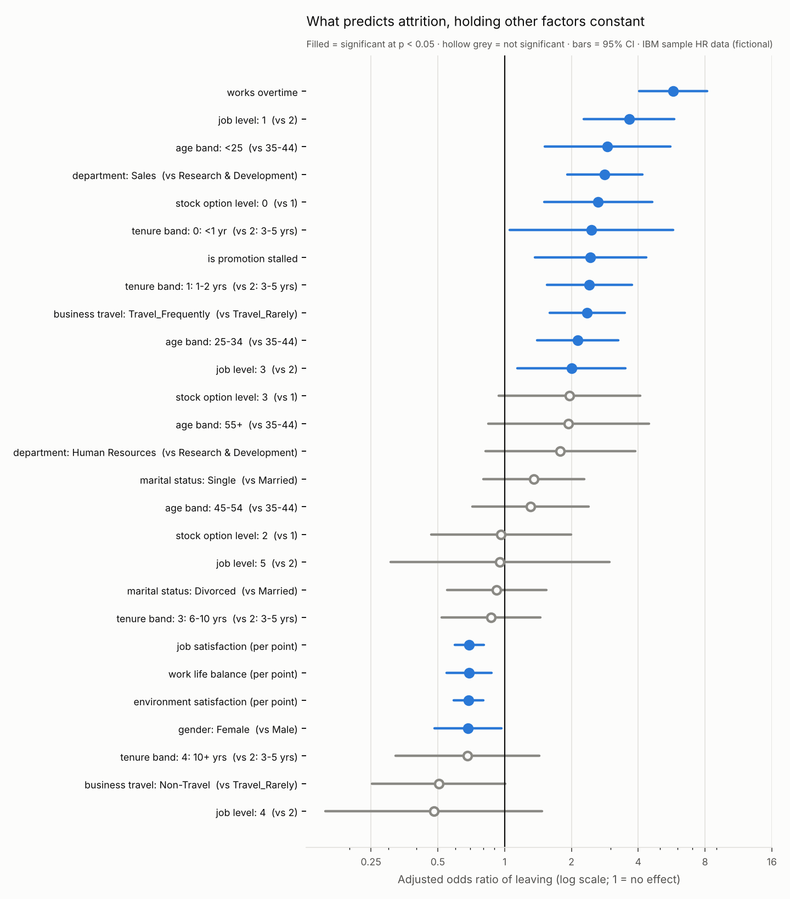

# Talent Analytics Platform on GCP

An end-to-end people-analytics pipeline: HRIS, applicant-tracking (ATS) job
postings and BLS labour-market data land in **Cloud Storage**, a **Dataflow**
job normalizes the postings, **BigQuery** holds a governed warehouse modelled
with **dbt**, **Cloud Composer** orchestrates it daily, and **BigQuery ML**
scores attrition risk behind an AUC gate and a fairness gate. Compensation and
demographic columns are protected with policy tags, dynamic masking and
row-level security, all provisioned with **Terraform**.

It answers three questions for three audiences, and adds a **statistical
significance layer** (chi-square with Benjamini–Hochberg correction, Wilson
intervals, multivariable logistic regression) that is **independently replicated
in R** and cross-checked against Python, a **KPI scorecard**, and a **validation
gate** that every Tableau / Power BI extract must pass before it is published.

| Audience | Question | Mart |
|---|---|---|
| HR business partners | Where and why are we losing people? | `fct_attrition_segments`, `mart_attrition_drivers` |
| Recruiting | Which roles will be hardest to backfill? | `mart_replacement_pressure`, `mart_open_roles` |
| Finance / leadership | Is our attrition high for our industry? | `mart_attrition_vs_benchmark` |
| HR leadership | Are we hitting retention KPIs, by department? | `mart_kpi_scorecard` |
| HRBPs / analysts | Which gaps are statistically real once other factors are held constant? | `reports/stats/` |

## Architecture



## What's in the repo

| Path | What it does | GCP service |
|---|---|---|
| `ingestion/` | Extractors for HRIS CSV, Greenhouse/Lever boards, BLS JOLTS → NDJSON in GCS | Cloud Storage |
| `pipelines/` | Apache Beam job: parses two ATS schemas, converts timezones, classifies role family & seniority, dedups, dead-letters bad rows | Dataflow |
| `dbt/` | Staging → intermediate → marts, 35 data tests, small-cell suppression, policy-tag and row-access post-hooks | BigQuery + dbt |
| `bqml/` | Train / evaluate / explain / score / fairness-audit / publish SQL, plus a local scikit-learn mirror | BigQuery ML |
| `orchestration/dags/` | Daily DAG with weekly retrain, AUC gate and four-fifths fairness gate | Cloud Composer |
| `terraform/` | Bucket, datasets, service account, IAM, taxonomy, policy tags, masking policies, optional Composer | IAM, Data Catalog, BigQuery data policies |
| `analysis/` | Significance layer: chi-square + BH, Wilson CIs, logistic regression, interaction test (Python) and an independent base-R replication (`analysis/r/`) | — |
| `dashboard/` | Looker Studio spec, Tableau / Power BI build guide, validated CSV extracts | Looker Studio, Tableau, Power BI |
| `docs/reporting_spec.md` | Stakeholder requirements, metric definitions, 13-item validation and test plan | — |
| `docs/data_dictionary.md` | Generated each run from the dbt manifest + warehouse | — |
| `docs/higher_ed_translation.md` | How the same pipeline maps to student retention and success | — |
| `reports/leadership_brief.md` | One-page, non-technical brief (generated) | — |
| `reports/validation_report.md` | Pre-publication checks: privacy, ranges, reconciliation, R/Python agreement | — |
| `docs/decisions.md` | Why each design choice was made | — |
| `reports/findings.md` | Generated findings (every number is queried, none typed in) | — |

## Results so far

From `reports/findings.md` (offline run; see the data caveat below):

- Company attrition is **16.1%** (237 of 1,470).
- **Overtime × early tenure is the sharpest signal:** employees with ≤ 2 years' tenure who work overtime are 7.1% of headcount but **22.4% of all leavers**, leaving at 51%. Without overtime the same tenure group leaves at ~21%.
- **It's statistically real, and it isn't a special new-hire effect.** Overtime has an adjusted odds ratio of **5.75 (95% CI 4.04–8.18)** after controlling for level, tenure, travel, department, equity, satisfaction and demographics. The overtime × early-tenure interaction is **not** significant (LR test p = 0.38): overtime multiplies risk similarly at every tenure, and new hires lose more people because their baseline is higher (a 30-point gap vs 16 points).
- 13 of 17 factors are significant after Benjamini–Hochberg correction; promotion stall is not significant alone but is once tenure is held constant (adjusted OR 2.4), a confounding effect the raw rates hide.
- Highest-risk segments: Laboratory Technicians in their first year (64%), Sales Representatives at 1–5 years (42–46%).
- The attrition model reaches a held-out **ROC AUC of 0.895** (local mirror), but **fails the age-band fairness gate** (ratio 0.40): with age excluded, tenure and job level still act as proxies. The DAG therefore withholds model scores from HRBPs and publishes only the descriptive marts — which is the point of having the gate.



**Data caveat.** The HRIS layer uses IBM's public *HR Analytics Employee
Attrition* dataset, which IBM describes as fictional. Treat findings as a
demonstration of method. Postings and JOLTS are real, live public data once
`make ingest` or the DAG runs.

## Run it locally (free, ~1 minute)

```bash
pip install -r requirements.txt
make local    # HRIS + offline ATS fixtures -> Beam (DirectRunner) -> DuckDB -> dbt build -> model -> findings
make ingest   # same, but with LIVE Greenhouse/Lever postings and BLS JOLTS (needs internet)
make test     # parser, Beam transform, DAG-integrity, statistics and extract-gate tests
make stats bi # re-run only the significance layer, R cross-check and validated BI extracts
```

`make local` uses hand-written ATS fixtures (boards named `fixture-*`) so it runs
offline; the marts exclude them, so they never reach a finding.

## Run it on Google Cloud

```bash
gcloud auth application-default login
cp terraform/terraform.tfvars.example terraform/terraform.tfvars   # set project, bucket, your user/groups
make gcp-infra                    # bucket, datasets, SA, IAM, policy tags, masking policies
pip install -r requirements-gcp.txt
make gcp-ingest gcp-load          # extract to GCS, load raw tables
make gcp-normalize                # Dataflow job
make gcp-dbt                      # dbt build on BigQuery with policy tags applied
# then run bqml/01..06 in the BigQuery console (or let Composer do it)
```

To demo scheduling, set `create_composer = true`, `make gcp-infra`, then
`make gcp-deploy-dags` and trigger `talent_analytics_daily` in the Airflow UI.

### Cost control
- BigQuery on-demand: this data is a few MB, so queries are effectively free within the monthly free tier.
- Dataflow: capped at 2 `e2-standard-2` workers; a run takes minutes.
- **Composer bills while it exists.** Turn it on, capture the run and screenshots, then set `create_composer = false` and apply again.
- `terraform destroy` removes everything (`force_destroy = true` by default for a portfolio project).

## What has and hasn't been verified

| Verified here | How |
|---|---|
| Ingestion parsers, Beam transforms, dead-letter routing | 32 pytest tests, Beam `TestPipeline` |
| Full pipeline end to end | `make local`: Beam DirectRunner → DuckDB → `dbt build` (11 models, 3 seeds, 50 data tests — all pass) → stats → extracts |
| Statistics | Independent base-R replication agrees with Python on 178 values (max difference ~1e-11) |
| Dashboard extracts | 8-check validation gate: no IDs or pay, small cells suppressed, every number reconciles to the warehouse |
| dbt compiles for BigQuery | `dbt compile --target bigquery` (offline) + BigQuery-dialect SQL parse of every compiled model |
| DAG structure and gate ordering | Airflow `DagBag` import + dependency tests |
| Benchmark mart arithmetic | Checked against a synthetic JOLTS series, then discarded |
| Terraform syntax | HCL parse; CI runs `terraform validate` |

Not yet verified: a real `terraform apply`, Dataflow and Composer runs in a GCP
project, and BigQuery ML training. Those need a GCP account and are the next step.

## Repo layout

```
analysis/       significance layer (Python) + independent R replication
ingestion/      extractors (HRIS, Greenhouse, Lever, BLS)
pipelines/      Beam/Dataflow normalizer + pure transforms
dbt/            models, seeds, tests, macros (cross-db, policy tags, row access, suppression)
bqml/           BigQuery ML SQL + local mirror
orchestration/  Composer DAG
terraform/      infrastructure and governance
dashboard/      Looker Studio spec, Tableau/Power BI guide, validated extracts
scripts/        local loader, fixture lander, findings builder, Composer deploy
tests/          pytest suite + fixtures
config/         boards, JOLTS series, BigQuery schemas
```
